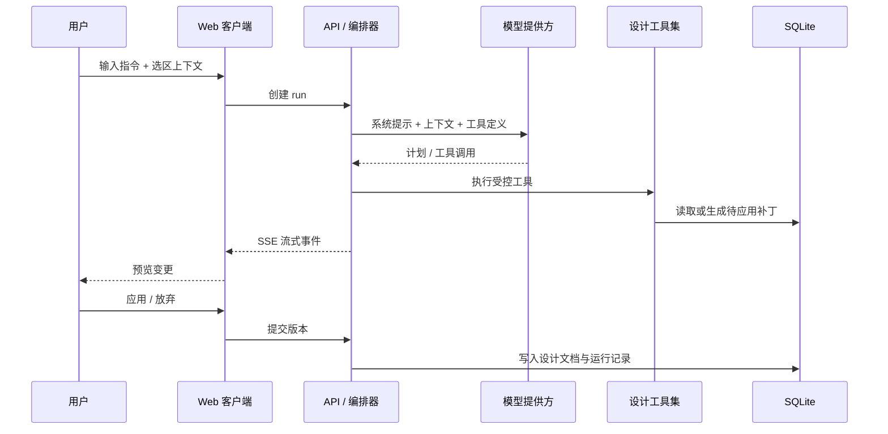

# Agent 设计

> 状态：草案 · 最后更新：2026-11-25

## 定位

Agent 不是独立的聊天窗口，而是设计编辑器的协作层。它以类型化工具操作结构化设计文档，把「用户意图」转换为「可审阅的设计变更」。

核心能力（规划）：

- **生成**：根据描述创建页面、区块与组件。
- **修改**：按指令调整布局、样式、文案与令牌。
- **解释**：说明现有设计结构、样式来源与不一致之处。
- **审查**：检查对比度、间距、命名与设计系统规范。
- **批量操作**：跨页面替换组件、统一字号或颜色。

## 运行模型

一次 **run** 包含：输入、计划、若干 **step**（消息、工具调用、补丁）、最终状态与成本统计。run 可取消、可回放、可审计。

## 工具设计

工具是 Agent 与系统之间唯一的写入通道，必须满足：

- **类型化**：输入输出使用共享 schema（`packages/shared`），服务端再次校验。
- **语义化**：围绕设计概念（节点、布局、样式、令牌），而非底层像素操作。
- **幂等或可补偿**：重复调用不产生意外副作用；失败可回滚。
- **最小权限**：按 run 的范围限制可访问的项目、页面与节点。
- **可解释**：每个工具调用记录参数摘要与结果，展示在运行详情中。

工具示例：

| 工具 | 作用 |
| --- | --- |
| `read_document` | 读取当前设计文档的摘要或指定子树 |
| `query_nodes` | 按类型、名称、样式条件查询节点 |
| `create_node` | 创建 Frame、文本、矩形等节点 |
| `update_node` | 修改属性、布局或样式 |
| `apply_token` | 将设计令牌应用到节点 |
| `create_patch` | 生成可预览、可撤销的变更补丁 |
| `export_design` | 导出为指定格式 |

写操作默认生成补丁而不是直接落库；只有用户确认或处于明确授权的自动模式时才提交版本。

## 上下文构建

- 当前项目与页面的结构摘要（节点数量、层级、关键 Frame）。
- 用户选中的节点及其祖先链、关键样式与令牌。
- 可用组件与设计令牌清单。
- 用户的显式指令与历史对话（按需裁剪）。
- 明确的约束：语言、主题、目标平台、尺寸。

后续可引入检索：相似页面、组件用法、团队规范。检索内容与用户输入一样视为不可信数据，不能覆盖系统规则。

## 人在回路

提供三种应用模式（命名待定）：

1. **建议**：只展示补丁与说明，用户手动应用。
2. **确认**：Agent 执行到补丁阶段，用户一键应用或放弃。
3. **自动（受限）**：在白名单工具与范围内自动提交，保留完整记录与撤销入口。

无论哪种模式，都必须支持：变更 diff、单步撤销、整次 run 回滚、运行历史查看。

## 流式与取消

- 使用 SSE 推送事件，前端按事件类型增量渲染，而不是等待整次运行结束。
- 事件包含序号，断线重连可按序号续传（后续实现）。
- 用户取消时发送取消信号，编排器停止后续工具调用，已产生的未提交补丁丢弃。
- 设置超时与最大工具调用轮次，防止无限循环。

## 安全与成本

- **Prompt 注入**：设计内容、文件名与检索结果均可能包含恶意指令，系统提示中明确数据与指令的边界；工具层做权限校验，不能依赖模型自觉。
- **密钥隔离**：模型密钥只存在于服务端，不进入客户端或模型上下文。
- **输出校验**：工具参数必须通过 schema；禁止模型输出直接执行 SQL、shell 或文件写入。
- **速率与配额**：按用户与项目限流，设置单次 run 的 token 与工具调用上限。
- **内容安全**：记录必要日志，敏感内容按保留策略处理；对外分享前提示用户检查。
- **成本可见**：运行详情展示 token 用量与耗时，为配额与计费提供依据。

## 可观测性

- 每个 run 记录：模型、提示版本、工具序列、耗时、token、错误码、是否被用户撤销。
- 指标：成功率、一次通过率、平均轮次、撤销率、每类工具失败率。
- 支持按 run 回放，用于复现问题与评估提示变更。

## 模型接入

- 通过统一的模型适配器接口接入不同提供方，隔离请求格式、流式协议与用量字段。
- 提示词与工具定义版本化，run 记录引用版本号，便于对比效果。
- 测试使用录制响应或模拟适配器，避免 CI 依赖外部模型。
- 对外 MCP 能力由 [MCP 集成](../integrations/mcp.md) 中的总控统一注册与鉴权，API Key 的 VCode / 密码权限在每次工具调用时重新校验。

## 分阶段落地

| 阶段 | 范围 |
| --- | --- |
| M3 初版 | 对话、单轮工具调用、补丁预览、应用 / 撤销、运行记录 |
| 后续 | 多步规划、自动模式、审查工具、检索增强、团队规范 |

## 开放问题

- 工具在服务端还是客户端执行：客户端执行延迟低，服务端执行更易控制权限与审计。
- 设计文档的 diff 表示：节点级补丁还是命令序列。
- 多 Agent 分工（生成 / 审查 / 修复）是否必要，何时引入。
- 模型提供方的降级与重试策略。
- 如何评估设计质量并形成可回归的基准集。
