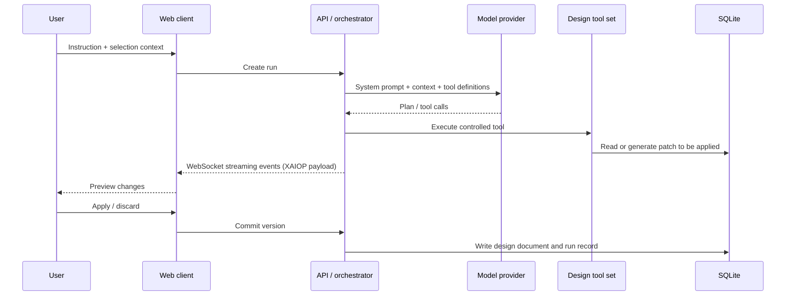

# Agent Design

> 中文原文：[overview.md](overview.md)
>
> Status: Draft · Last updated: 2026-11-26

## Positioning

The Agent is not a separate chat window; it is the collaboration layer of the design editor. It operates on the structured design document through typed tools, translating "user intent" into "reviewable design changes".

Core capabilities (planned):

- **Generate**: create pages, sections, and components from descriptions.
- **Modify**: adjust layout, styles, copy, and tokens per instructions.
- **Explain**: describe the existing design structure, where styles come from, and where inconsistencies lie.
- **Review**: check contrast, spacing, naming, and design system compliance.
- **Batch operations**: replace components across pages, unify font sizes or colors.

## Run model

A **run** contains: input, plan, several **steps** (messages, tool calls, patches), final state, and cost statistics. A run can be cancelled, replayed, and audited.

## Tool design

Tools are the only write channel between the Agent and the system, and they must be:

- **Typed**: input and output use shared schemas (`packages/shared`) and are re-validated on the server.
- **Semantic**: centered on design concepts (nodes, layout, styles, tokens) rather than low-level pixel operations.
- **Idempotent or compensable**: repeated calls do not cause unexpected side effects; failures can be rolled back.
- **Least privilege**: restrict the projects, pages, and nodes that can be accessed to the scope of the run.
- **Explainable**: every tool call records a parameter summary and result, shown in run details.

Tool examples:

| Tool | Purpose |
| --- | --- |
| `read_document` | Read a summary of the current design document or a specified subtree |
| `query_nodes` | Query nodes by type, name, or style conditions |
| `create_node` | Create Frame, text, rectangle, and other nodes |
| `update_node` | Modify properties, layout, or styles |
| `apply_token` | Apply design tokens to nodes |
| `create_patch` | Generate a previewable, undoable change patch |
| `export_design` | Export to a specified format |

Write operations generate patches by default instead of writing directly to the database; a version is committed only after user confirmation or in an explicitly authorized automatic mode.

## Context construction

- A structural summary of the current project and page (node count, hierarchy, key Frames).
- The user's selected nodes and their ancestor chain, key styles, and tokens.
- The list of available components and design tokens.
- The user's explicit instructions and conversation history (trimmed as needed).
- Explicit constraints: language, theme, target platform, and dimensions.

Retrieval may be introduced later: similar pages, component usage, and team guidelines. Retrieved content, like user input, is treated as untrusted data and must not override system rules.

## Human in the loop

Three application modes are planned (names TBD):

1. **Suggest**: only show patches and explanations; the user applies them manually.
2. **Confirm**: the Agent runs through the patch stage, and the user applies or discards with one click.
3. **Auto (restricted)**: commit automatically within allowlisted tools and scope, retaining complete records and an undo entry point.

Whichever mode is used, the following must be supported: change diffs, single-step undo, whole-run rollback, and run history.

## Streaming and cancellation

- Push events through the existing single WebSocket realtime channel (see [Realtime channel](../architecture/realtime_en.md)); the frontend renders incrementally by event type instead of waiting for the entire run to finish.
- Structured incremental payloads are encoded with XAIOP, produced by the server and parsed by the frontend; staged commits and checkpoint history are supported. XAIOP is an encoding layer and does not change the WebSocket envelope. See [XAIOP integration](../integrations/xaiop_en.md).
- Events carry sequence numbers, and a reconnecting client can resume by sequence number (to be implemented).
- When the user cancels, a cancellation signal is sent; the orchestrator stops subsequent tool calls, and uncommitted patches already produced are discarded.
- Set timeouts and a maximum number of tool-call rounds to prevent infinite loops.

## Security and cost

- **Prompt injection**: design content, file names, and retrieval results may contain malicious instructions. The system prompt makes the boundary between data and instructions explicit; the tool layer enforces permissions and cannot rely on the model's good behavior.
- **Secret isolation**: model keys exist only on the server and never enter the client or the model context.
- **Output validation**: tool parameters must pass schema validation; model output is never allowed to execute SQL, shell commands, or file writes directly.
- **Rate and quota**: rate-limit by user and project, and cap tokens and tool calls per run.
- **Content safety**: keep the necessary logs and handle sensitive content according to the retention policy; prompt users to review before sharing externally.
- **Cost visibility**: run details show token usage and elapsed time, providing the basis for quotas and billing.

## Observability

- Each run records: model, prompt version, tool sequence, elapsed time, tokens, error codes, and whether the user undid it.
- Metrics: success rate, first-pass rate, average rounds, undo rate, and failure rate per tool type.
- Run replay supports reproducing issues and evaluating prompt changes.

## Model integration

- Connect different providers through a unified model adapter interface that isolates request formats, streaming protocols, and usage fields.
- Prompts and tool definitions are versioned; run records reference version numbers to make comparisons easier.
- Tests use recorded responses or mock adapters so CI does not depend on external models.
- External MCP capabilities are registered and authenticated centrally by the controller described in [MCP integration](../integrations/mcp_en.md); API Key VCode / password permission bits are re-checked on every tool call.

## Phased rollout

| Phase | Scope |
| --- | --- |
| M3 initial | Chat, single-turn tool calls, patch preview, apply / undo, run records |
| Later | Multi-step planning, automatic mode, review tools, retrieval augmentation, team guidelines |

## Open questions

- Whether tools execute on the server or the client: client execution has lower latency, while server execution makes permissions and auditing easier to control.
- Diff representation for the design document: node-level patches or command sequences.
- Whether multi-Agent division of labor (generate / review / fix) is necessary, and when to introduce it.
- Degradation and retry strategy for model providers.
- How to evaluate design quality and build a regression-capable benchmark set.
