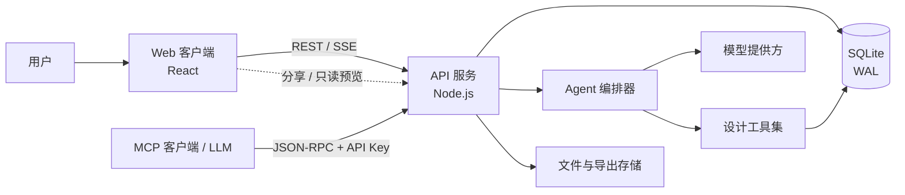

# 架构总览

> 状态：M1 部分实现 · 最后更新：2026-11-25

## 目标与约束

- **产品目标**：AI 驱动的在线 UI 设计，跨平台访问，Agent 可对结构化设计文档执行操作。
- **技术约束**：前端 React，后端 Node.js，数据库 SQLite；中文为主、英文为辅。
- **体验约束**：深色 / 浅色主题与 zh-CN / en-US 从第一版起就是原生能力。
- **部署约束**：优先支持单机部署与本地开发；为未来拆分服务保留边界。

## 架构原则

1. **结构化优先**：设计文档是可校验、可版本化的数据，Agent 与 UI 共享同一套 schema。
2. **单向数据流**：UI 读取文档状态，变更通过命令 / 补丁进入，便于撤销、审计与回放。
3. **边界清晰**：前端不直接访问数据库；共享契约放在 `packages/shared`。
4. **渐进复杂**：先单进程 API + SQLite，按瓶颈再引入队列、缓存或独立服务。
5. **可替换**：模型提供方、画布渲染器与存储层均通过接口隔离。

## 系统上下文

规划中的代码边界：

- `apps/web`：编辑器、Agent 面板、设置与主题 / 语言切换。
- `apps/server`：HTTP API、鉴权、设计文档服务、Agent 编排、数据访问。
- `packages/shared`：设计文档 schema、API DTO、工具协议、主题与 locale 常量。

## 运行时组件

| 组件 | 职责 | 现状 |
| --- | --- | --- |
| Web 客户端 | 编辑器 UI、画布渲染、状态管理、i18n、主题 | 项目页 / 账号 / 个人面板已实现 |
| API 服务 | REST/SSE 接口、鉴权、校验、限流、日志 | 认证、模型与 MCP API 已实现 |
| MCP 服务 | 能力注册、API Key 权限、`tools/list` / `tools/call`、llms.txt | 已实现 |
| 设计文档服务 | 读取 / 写入结构化文档、版本与补丁 | 待搭建 |
| Agent 编排器 | 规划、工具调用、流式事件、运行记录 | 待搭建 |
| XAIOP SDK | 结构化数据的流式编解码（Node / browser / core） | 已 vendored |
| SQLite | 用户、会话、项目、设计文档、Agent 运行记录 | 用户 / 会话已接入 |
| 文件存储 | 上传图片、导出文件；开发期落本地磁盘 | 头像已接入 |

## 关键数据流

### 编辑设计

1. 用户在画布中操作，生成领域命令（如移动节点、修改填充）。
2. 客户端在本地应用命令并维护撤销栈。
3. 变更以补丁 / 快照节流同步到 API。
4. 服务端校验 schema 与权限后写入 SQLite，并返回版本号。
5. 其他标签页或设备通过版本号检测是否需要刷新。

### Agent 任务

1. 客户端提交指令、选区与上下文摘要。
2. API 创建运行记录（run），交由编排器处理。
3. 编排器调用模型，模型返回工具调用；工具在服务端或客户端受控执行。
4. 变更先形成「待应用补丁」，通过 XAIOP 流式推送给客户端预览（[集成说明](../integrations/xaiop.md)）。
5. 用户确认后提交为新版本；运行、工具调用与结果全部留痕，可回放与撤销。

## 跨平台策略

- **浏览器优先**：以 Web 为标准实现，使用响应式布局与 Pointer Events 同时覆盖鼠标、触控与触控笔。
- **PWA 增强**：安装、离线草稿与通知作为增强能力，不作为基础依赖。
- **桌面客户端**：编辑器的文件系统访问、快捷键与多窗口需求出现后再评估（Tauri 等方案）。
- **数据一致**：跨端共享同一 API 与设计文档 schema，不在客户端各自定义格式。

## 非功能性要求

- **性能**：编辑操作保持主线程响应；大文档按视口与节点懒加载；首屏与主题切换不闪烁。
- **可访问性**：键盘可达、焦点可见、语义标签、对比度达到 WCAG AA。
- **安全**：鉴权、输入校验、限流、上传白名单；Agent 工具按最小权限执行。
- **隐私**：项目默认私有；模型调用与数据留存策略对用户透明。
- **可观测性**：结构化日志、请求 ID、Agent 运行轨迹与关键指标。
- **备份**：SQLite 定期快照，提供恢复演练步骤。

## 技术选型记录

- [ADR 0001：技术栈](../decisions/0001-tech-stack.md)
- [ADR 0002：仓库结构](../decisions/0002-monorepo.md)
- [ADR 0003：主题与 i18n 作为一等能力](../decisions/0003-theming-and-i18n.md)
- [ADR 0004：以 vendored 源码集成 XAIOP](../decisions/0004-xaiop-integration.md) · [集成文档](../integrations/xaiop.md)
- [MCP 集成与 API Key 权限](../integrations/mcp.md)
- [ADR 0005：账号认证与头像存储](../decisions/0005-auth-and-avatar.md)

## 待确认问题

- 画布渲染路线（DOM / SVG / Canvas / WebGL）与设计文档 schema 的对应关系。
- 设计文档的协作模型：乐观并发、版本号还是 CRDT。
- 文件存储的抽象方式（本地磁盘 / S3 兼容对象存储）。
- Agent 工具在客户端执行还是服务端执行的边界划分。
- 是否引入消息队列处理长任务，或先使用进程内任务表。
