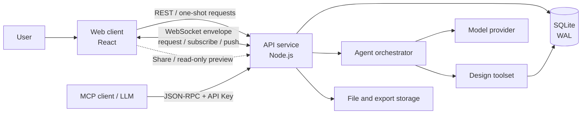

# Architecture Overview

> 中文原文：[overview.md](overview.md)
>
> Status: M1 partially implemented · Last updated: 2026-11-25

## Goals and constraints

- **Product goal**: AI-driven online UI design with cross-platform access, where Agents can perform operations on structured design documents.
- **Technical constraints**: React front end, Node.js backend, SQLite database; Chinese primary, English secondary.
- **Experience constraints**: Dark / light themes and zh-CN / en-US are native capabilities from the first version.
- **Deployment constraints**: Single-machine deployment and local development come first; boundaries are preserved for a future service split.

## Architecture principles

1. **Structured first**: Design documents are verifiable, versionable data, and the Agent and the UI share the same schema.
2. **Unidirectional data flow**: The UI reads document state; changes enter as commands / patches, which makes undo, audit, and replay possible.
3. **Clear boundaries**: The front end never accesses the database directly; shared contracts live in `packages/shared`.
4. **Progressive complexity**: Start with a single-process API + SQLite, then introduce queues, caches, or separate services as bottlenecks appear.
5. **Replaceable**: Model providers, canvas renderers, and storage layers are all isolated behind interfaces.

## System context

Planned code boundaries:

- `apps/web`: editor, Agent panel, settings, and theme / language switching.
- `apps/server`: HTTP API, authentication, design document service, Agent orchestration, and data access.
- `packages/shared`: design document schema, API DTOs, tool protocol, and theme and locale constants.

## Runtime components

| Component | Responsibility | Current state |
| --- | --- | --- |
| Web client | Editor UI, canvas rendering, state management, i18n, theme | Project page, account, profile panel, models, and API panel implemented |
| API service | REST / WebSocket interfaces, authentication, validation, rate limiting, logging | Authentication, model, MCP, and realtime APIs implemented |
| Realtime gateway | Single WebSocket connection, envelope routing, subscriptions, push, and reconnection | Base implemented |
| MCP service | Capability registration, API Key permissions, `tools/list` / `tools/call`, llms.txt | Implemented |
| Design document service | Reading / writing structured documents, versions, and patches | Not started |
| Agent orchestrator | Planning, tool calls, streaming events, run records | Not started |
| XAIOP SDK | Streaming codec for structured data (Node / browser / core) | Vendored; application integration not started |
| SQLite | Users, sessions, projects, design documents, Agent run records | Users, sessions, VCode, exports, projects, model providers, preferences, and API keys integrated |
| File storage | Uploaded images, exported files; local disk during development | Avatars and export files integrated |

## Key data flows

### Editing a design

1. The user interacts on the canvas, producing domain commands (such as moving a node or changing a fill).
2. The client applies the commands locally and maintains an undo stack.
3. Changes are throttled and synced to the API as patches / snapshots.
4. The server validates the schema and permissions, writes to SQLite, and returns a version number.
5. Other tabs or devices use the version number to detect whether they need to refresh.

### Agent tasks

1. The client submits an instruction, selection, and context summary.
2. The API creates a run record (run) and hands it to the orchestrator.
3. The orchestrator calls the model, which returns tool calls; tools execute under control on the server or client.
4. Changes first form a "pending patch" and are streamed to the client for preview over the single WebSocket realtime channel as XAIOP payloads ([XAIOP integration](../integrations/xaiop_en.md) · [Realtime channel](realtime_en.md)).
5. After user confirmation, the change is committed as a new version; runs, tool calls, and results are all recorded and can be replayed and undone.

## Cross-platform strategy

- **Browser first**: The web platform is the reference implementation, using responsive layout and Pointer Events to cover mouse, touch, and stylus at the same time.
- **PWA enhancements**: Installation, offline drafts, and notifications are enhancements, not baseline dependencies.
- **Desktop client**: Evaluate file system access, keyboard shortcuts, and multi-window needs for the editor later (Tauri and similar options).
- **Data consistency**: All platforms share the same API and design document schema; clients do not define their own formats.

## Non-functional requirements

- **Performance**: Editing stays responsive on the main thread; large documents load lazily by viewport and node; the first screen and theme switching do not flicker.
- **Accessibility**: Keyboard reachable, visible focus, semantic labels, and WCAG AA contrast.
- **Security**: Authentication, input validation, rate limiting, and upload allowlists; Agent tools run with least privilege.
- **Privacy**: Projects are private by default; model calls and data retention policies are transparent to users.
- **Observability**: Structured logs, request IDs, Agent run traces, and key metrics.
- **Backup**: Regular SQLite snapshots and documented recovery drills.

## Technology decisions

- [ADR 0001: Technology stack](../decisions/0001-tech-stack_en.md)
- [ADR 0002: Repository structure](../decisions/0002-monorepo_en.md)
- [ADR 0003: Theming and i18n as first-class capabilities](../decisions/0003-theming-and-i18n_en.md)
- [ADR 0004: Integrating XAIOP as vendored source](../decisions/0004-xaiop-integration_en.md) · [Integration document](../integrations/xaiop_en.md)
- [MCP integration and API Key permissions](../integrations/mcp_en.md)
- [Realtime channel: single connection, envelope, subscriptions, and push](realtime_en.md)
- [ADR 0005: Account authentication and avatar storage](../decisions/0005-auth-and-avatar_en.md)

## Open questions

- The canvas rendering approach (DOM / SVG / Canvas / WebGL) and how it maps to the design document schema.
- The design document collaboration model: optimistic concurrency, version numbers, or CRDT.
- The file storage abstraction (local disk / S3-compatible object storage).
- The boundary between client-side and server-side execution of Agent tools.
- Whether to introduce a message queue for long tasks, or start with an in-process task table.
